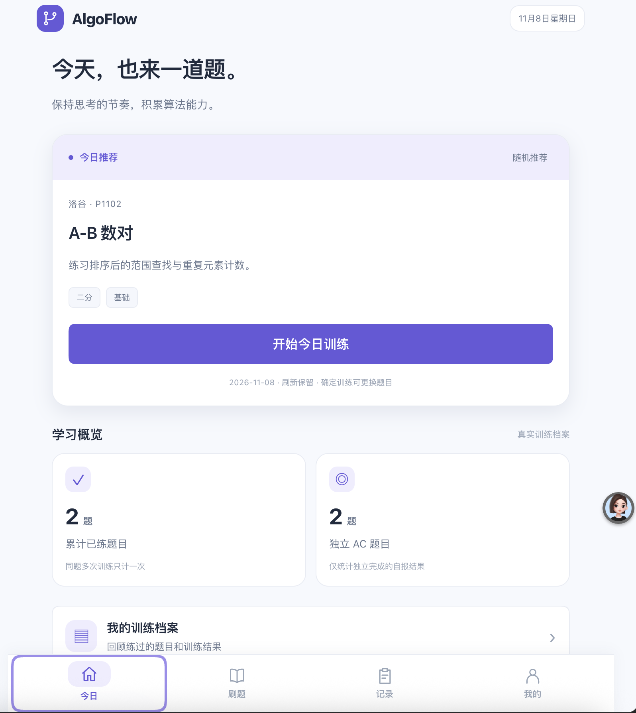
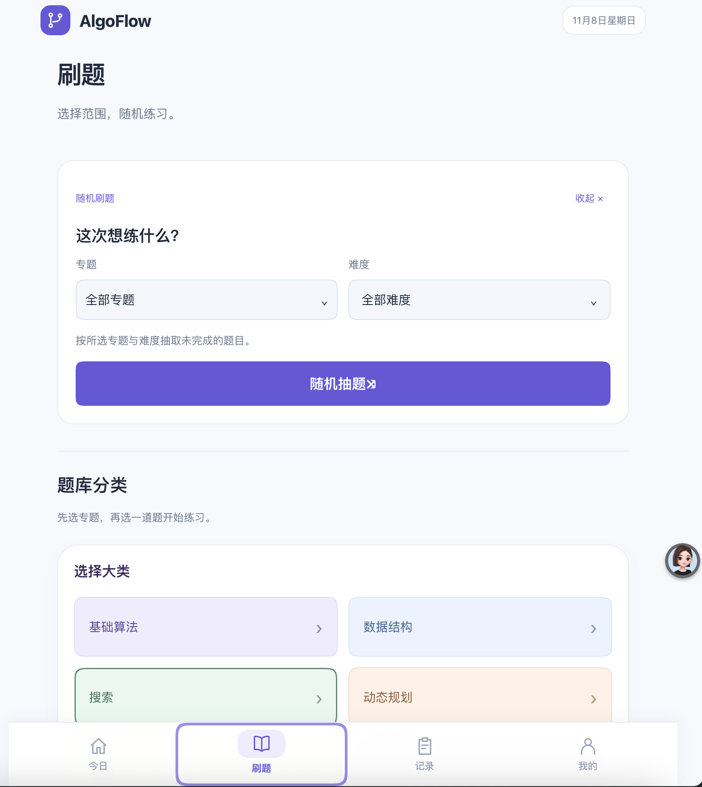
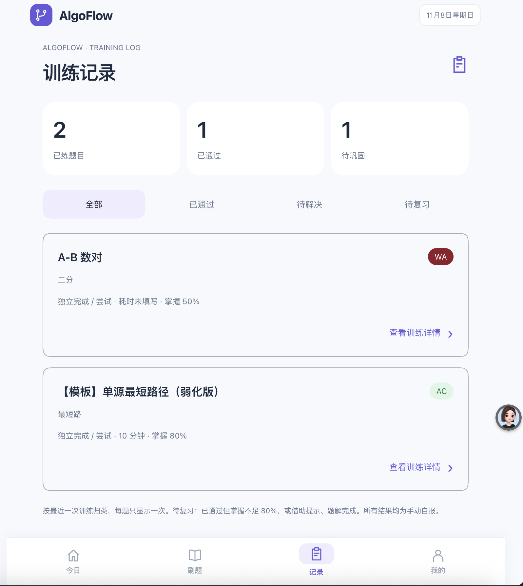
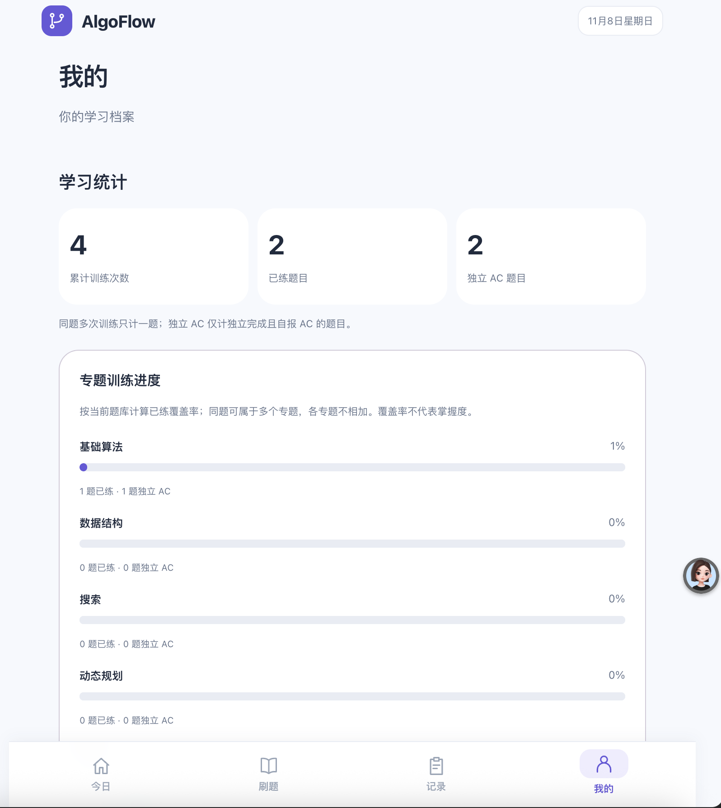
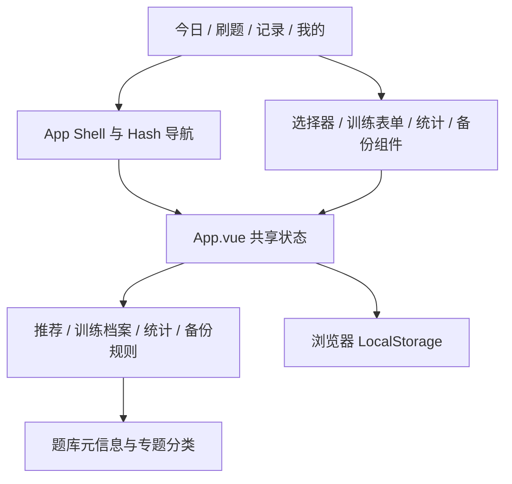

# AlgoFlow

个人算法训练应用 —— 每日推荐、随机练习、训练档案和学习统计，为 iPhone 优先设计。

## 为什么用它

AlgoFlow 把选题、练习、记录和回顾放在同一个学习空间中：

- 每日推荐 —— 打开即可开始一道题，也能选择专题和难度后确定训练。
- 专题题库 —— 按大类、子专题逐级浏览，支持名称、题号、来源与难度筛选。
- 随机练习 —— 过滤已完成题，筛选与抽题结果刷新后可恢复。
- 完整训练档案 —— 不只记录 AC，WA、TLE 和未完成的尝试也能保留。
- 轻量复盘 —— 必填结果、完成方式和掌握程度，耗时、错因与笔记按需填写。
- 本地备份 —— 无需登录，支持 JSON 导出与预览确认后的安全合并导入。

## 截图

以下为实际使用界面的操作截图，由项目作者提供。图中的题目、训练结果和统计对应截图时的本地状态，并非固定示例或题库上限。

<table>
  <tr>
    <th width="50%">今日 · 打开就能开始的一道题</th>
    <th width="50%">刷题 · 随机抽题与专题题库</th>
  </tr>
  <tr>
    <td><a href="docs/screens/today.png"></a></td>
    <td><a href="docs/screens/practice.png"></a></td>
  </tr>
  <tr>
    <td>查看推荐题目的来源、专题和难度，一键进入训练；下方展示真实学习概览，并提供训练档案入口。</td>
    <td>选择专题和难度后随机练习，也可以逐级浏览基础算法、数据结构、搜索和动态规划等分类。</td>
  </tr>
  <tr>
    <th>记录 · 每次尝试都留下痕迹</th>
    <th>我的 · 看见积累与学习进度</th>
  </tr>
  <tr>
    <td><a href="docs/screens/records.png"></a></td>
    <td><a href="docs/screens/profile.png"></a></td>
  </tr>
  <tr>
    <td>AC、WA、TLE 和未完成均归入同一份档案。同题在列表只显示一次，点开可回顾完整历史、错因与笔记。</td>
    <td>统计由训练记录实时计算，区分训练次数和去重题数；专题进度展示已练覆盖率，不把做过等同于掌握。</td>
  </tr>
</table>

点击截图可查看原图。截图展示的是各页当前可见区域；日历和 JSON 导入导出等功能位于「我的」页面下方。

## 功能

### 今日与每日推荐

- 展示今日题目、专题、难度、来源和训练方向，进入详情后可打开原题。
- 未确认专题时默认随机推荐；选择专题和难度后点击「确定训练」，立即更新当前训练题目。
- 当前选择按设备本地日期保存，普通刷新不换题；确认训练可以主动更换。
- 完成今日任务后自动显示祝贺与七彩烟花，当天只自动庆祝一次；尊重减少动态效果设置。
- 学习概览读取真实训练记录，不使用示例统计。

### 题库浏览与随机练习

- 按大类、子专题逐级浏览题库，也可以按名称或题号搜索，并筛选难度和来源。
- 随机模式支持专题和难度过滤，排除已完成题；多候选时避免连续抽中同一道。
- 候选不足时明确提示，不无限重抽、不擅自放宽条件。
- 随机筛选和结果通过浏览器历史快照恢复；恢复时检查题目是否存在、匹配筛选且尚未完成。
- 题库收录洛谷、LeetCode 的题目元信息和原题链接，数量可持续扩充，没有固定上限。

### 训练记录与学习档案

- AC、WA、TLE、未完成均可记录，结果明确标记为手动自报，不冒充 OJ 官方判题。
- 列表按题目 ID 去重，显示最近一次结果、完成方式、耗时和掌握程度。
- 支持「全部、已通过、待解决、待复习」筛选。
- 同题允许反复训练，详情中可查看完整历史、错因和笔记，并编辑、删除或重新训练。
- 已完成状态以该题最近一次训练为准；尚无训练记录时兼容旧版手动完成标记。
- 待复习采用简单规则：最近已 AC，但掌握不足 80% 或借助提示、题解完成。不单独维护一份错题数据。

### 学习统计与数据备份

- 实时计算累计训练次数、去重已练题目数和独立 AC 题目数。
- 独立 AC 只统计有独立完成且自报 AC 记录的题目，同题不重复计数。
- 展示专题已练覆盖率和训练日历；覆盖率不是掌握度，多专题数据不能直接相加。
- 导出版本化 JSON 备份。
- 导入前校验并预览新增、重复和冲突数量，用户确认后才保存。
- 按训练记录 ID 安全合并：重复跳过，冲突保留本地；未知题目或非法文件明确拒绝。
- 导入不覆盖本机学习设置和今日推荐。

## 架构

AlgoFlow 是 Vue 3.5 + Vite 单页应用，使用 JavaScript 和 CSS，页面以 Composition API 与 `<script setup>` 编写。浏览器本地保存训练档案，当前没有 Java 后端或云数据库。



| 目录或文件 | 职责 |
| --- | --- |
| `src/pages` | 四个主页面；部分页面仍通过插槽承接 App.vue 内容 |
| `src/components` | App Shell、底部导航、选择器、题库浏览、训练表单、统计与备份界面 |
| `src/data` | 题库 JSON、稳定题目 ID 和专题分类树 |
| `src/lib` | 推荐、随机快照、训练记录、档案筛选、统计与备份合并 |
| `src/App.vue` | 连接页面、共享状态、导航及本地读写 |
| `src/style.css` | 浅色紫色 UI、公共布局与移动端适配 |
| `public` | Manifest 和应用安装图标 |
| `tests` | Node.js 规则与数据处理回归测试 |

```text
src/
├── App.vue                页面连接、导航与共享状态
├── main.js                Vue 启动入口
├── style.css              公共样式与 UI 2.0 配色
├── pages/                 今日、刷题、记录、我的
├── components/            底栏、选择器、题库、记录表单、统计与导入组件
├── data/                  题库元信息与专题分类树
└── lib/                   推荐、快照、训练档案、统计与备份处理
public/
├── manifest.webmanifest   主屏幕安装配置
└── icons/                 应用图标与 Apple Touch Icon
tests/                     自动化规则测试
vercel.json                构建、SPA 回退与缓存配置
```

界面使用 Vue 3 Composition API 和 `<script setup>`，业务代码主要为 JavaScript，样式使用 CSS。导航沿用 Hash 路径和 History API，没有引入 Vue Router、Vant 或图表库。

`pages/ReviewPage.vue` 沿用了早期文件名，实际对应底部「记录」，是完整训练档案，并非仅展示错题。

几条贯穿项目的约定：

- 每次训练独立保存，编辑更新原记录，不凭空新增一次训练。
- 手动自报与官方判题严格区分，AC 不等同于掌握。
- 备份先校验、预览，再确认写入；同 ID 冲突默认保留本地。
- 本地数据与题库分开管理，个人备份不入库；文档截图仅使用明确选定的展示图片。
- UI 保持浅色紫色、柔和圆角，不使用右上斜箭头作为导航提示。

## 开发与测试

```bash
npm ci            # 按锁文件安装依赖
npm run dev       # 启动开发服务
npm test          # 运行规则与数据处理测试
npm run build     # 生成生产产物 dist/
npm run preview   # 本机预览生产构建
```

- 测试覆盖推荐稳定性、题库兼容、随机状态恢复、训练记录、统计、档案归类和备份合并。
- 浏览器验收使用隔离上下文，避免清空或覆盖真实训练数据。
- 手机调试可运行 `npm run dev -- --host 0.0.0.0`，用同一 Wi-Fi 的手机访问终端显示的 Network 地址。
- iPhone Safari 的安全区域、软键盘与文件操作仍需要真机验收，桌面模拟尺寸不能完全替代。

## 本地访问与数据迁移

电脑端打开开发服务显示的 Local 地址；手机端使用电脑的局域网地址，不能直接把电脑的 localhost 填到手机。

数据按浏览器和访问地址隔离。切换设备、端口或域名后，不会自动出现原有记录。请先在旧地址导出 JSON，再在新地址的「我的 → 数据管理」中选择备份，查看预览并确认合并。

## 数据保存与功能边界

训练档案保存在浏览器 **LocalStorage** 中，当前没有账号、数据库或云同步。题目正文和判题仍由原平台提供，AlgoFlow 不同步 OJ 提交。

请注意：

- 数据按浏览器和访问地址隔离。电脑与手机、localhost 与线上域名不会自动共享记录。
- 清理站点数据可能删除本地档案，请定期导出备份。
- JSON 可以包含你的训练结果和私人笔记，建议妥善保存，不提交到公开仓库。
- 跨设备迁移需要在原设备导出，再到新设备选择备份、查看预览并确认导入。
- 没有接入 AI 模型；「AI 解题教练」和「AI 复盘分析」目前只是后续功能的位置说明。

## 使用与安装

在浏览器访问实际部署的站点即可使用。iPhone 用户可用 Safari 打开 HTTPS 地址，通过分享菜单选择「添加到主屏幕」；如出现「作为网页 App 打开」，保持开启。

已提供 Manifest、独立显示模式、Apple Touch Icon 和安全区域配置。当前不是原生 iOS App，没有 APK 或 IPA 安装包；未注册 Service Worker，不承诺离线启动。

## 自行构建

建议使用满足项目 Vite 要求的 Node.js 22.12+ LTS 环境。

```bash
git clone https://github.com/xmy-yunze/AlgoFlow.git
cd AlgoFlow
npm ci
npm test
npm run build
```

构建结果位于 `dist/`。仓库包含 Vercel 构建、SPA 回退与缓存配置；部署需要关联你自己的项目。静态前端运行不需要模型密钥、数据库连接或登录服务。

## 反馈

欢迎通过 [Issues](https://github.com/xmy-yunze/AlgoFlow/issues) 提交问题或建议，附上设备、浏览器、复现步骤和截图。分享前请遮挡私人训练笔记，不上传个人 JSON 档案。

题目来源以题库中的原题链接为准；专题组织参考 [AlgoTemplate](https://algotemplate.site/blue_bridge_cup/all/dp.html)。README 结构参考 [MobileGH](https://github.com/sheep-programmer/mobilegh)，介绍、功能、截图和架构均为 AlgoFlow 自身内容。
